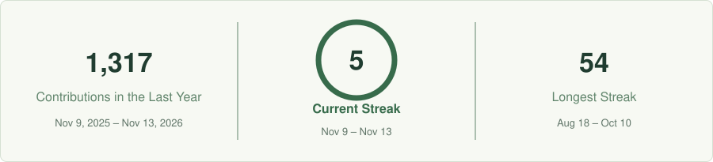
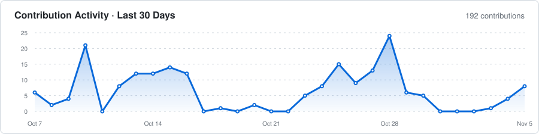

  

  <a href="https://github.com/miqbaltrim?tab=repositories">Explore repositories</a>
  &nbsp; &middot; &nbsp;
  <a href="https://www.linkedin.com/in/muhammadiqbal-3m">LinkedIn</a>
  &nbsp; &middot; &nbsp;
  <a href="https://www.instagram.com/ibaal.te/">Instagram</a>

 

## About

I'm **Iqbal**, a Full Stack Developer, Mobile Developer, and Data Analyst. I build useful, reliable digital products that connect thoughtful design with real business needs.

My work spans web and mobile applications, operational systems, and data analytics &middot; from simplifying everyday workflows to turning business data into clear, actionable insights.

 

## Areas of practice

<table width="100%">
<tr>
<td width="50%" valign="top">
<h3>01 &nbsp; Web &amp; Business Systems</h3>

Web applications and backend services for everyday operations, including ERP, SFA, budgeting, approval workflows, and automation.

LARAVEL / PHP / JAVASCRIPT / REST API

</td>
<td width="50%" valign="top">
<h3>02 &nbsp; Mobile Applications</h3>

Cross-platform applications with clear interfaces and reliable connections to business systems.

FLUTTER / DART / MOBILE UI

</td>
</tr>
<tr>
<td width="50%" valign="top">
<h3>03 &nbsp; Data &amp; Analytics</h3>

Dashboards, reporting, and automation that make complex business data easier to understand and use.

EXCEL / POWER BI / POWER PIVOT / PYTHON / VBA

</td>
<td width="50%" valign="top">
<h3>04 &nbsp; Interface &amp; Visual Design</h3>

Considered interfaces and visual identities that balance clarity, usability, and character.

FIGMA / PHOTOSHOP / ILLUSTRATOR / UI &amp; UX

</td>
</tr>
</table>

 

## Tools of the trade

| Discipline | Technologies & tools |
| :--- | :--- |
| Backend | PHP &middot; Laravel &middot; Node.js &middot; REST API |
| Frontend | React &middot; Next.js &middot; JavaScript &middot; Tailwind CSS &middot; Bootstrap &middot; HTML &middot; CSS |
| Mobile | Flutter &middot; Dart |
| Databases | PostgreSQL &middot; MySQL |
| Data & reporting | Excel &middot; Power Pivot &middot; Power BI &middot; Python &middot; Macros / VBA |
| Design | Figma &middot; Adobe Photoshop &middot; Adobe Illustrator |
| Development | Git &middot; GitHub &middot; VS Code &middot; Postman &middot; Laragon |
| AI assistance | OpenAI Codex &middot; Claude |

 

## Working principles

**Understand the problem.** Start with the context, the people, and the outcome that matters.

**Build with care.** Translate clear thinking into accessible design, maintainable code, and reliable experiences.

**Refine with evidence.**Damn Learn from real use, measure the impact, and improve the details over time.

 

## GitHub activity

<picture>
  <source media="(prefers-color-scheme: dark)" srcset="assets/github-streak-dark.svg" />
  
</picture>

  

<picture>
  <source media="(prefers-color-scheme: dark)" srcset="assets/github-activity-dark.svg" />
  
</picture>

View contribution animation

 
<picture>
  <source media="(prefers-color-scheme: dark)" srcset="assets/github-contribution-grid-snake-dark.svg" />
  
</picture>

 

---

  <em>Thoughtful design. Reliable engineering. Meaningful outcomes.</em>

  <a href="https://www.linkedin.com/in/muhammadiqbal-3m">Let's connect</a>
  &nbsp; &middot; &nbsp;
  <a href="https://github.com/miqbaltrim">@miqbaltrim</a>

